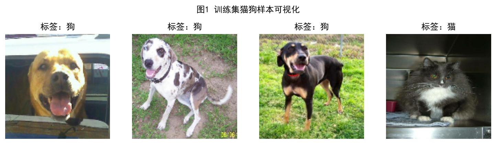
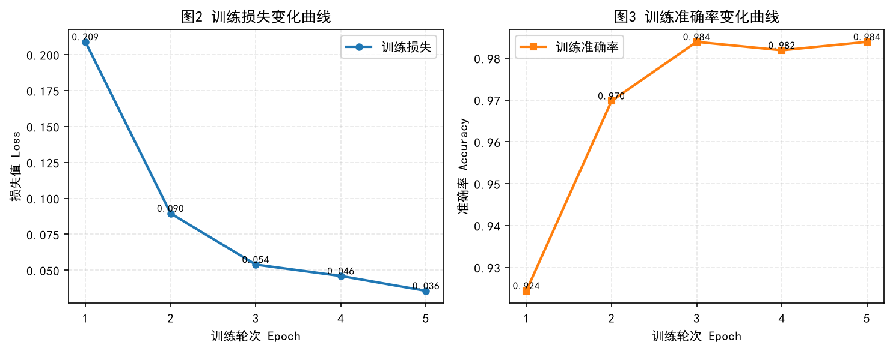
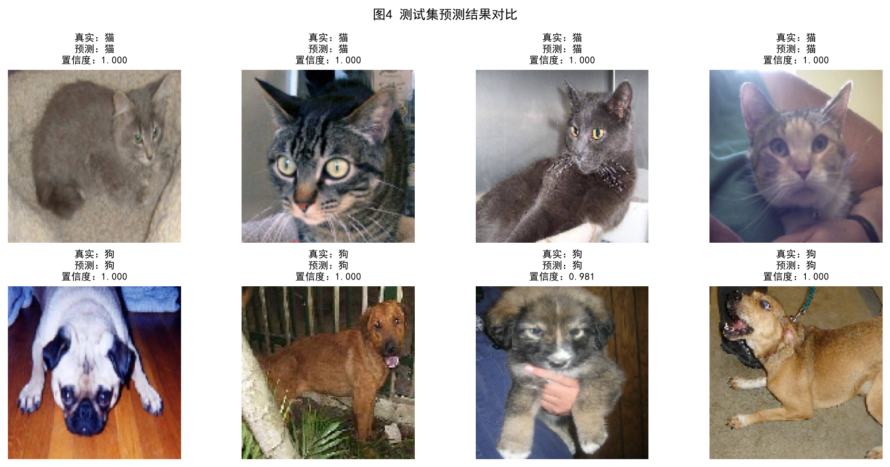
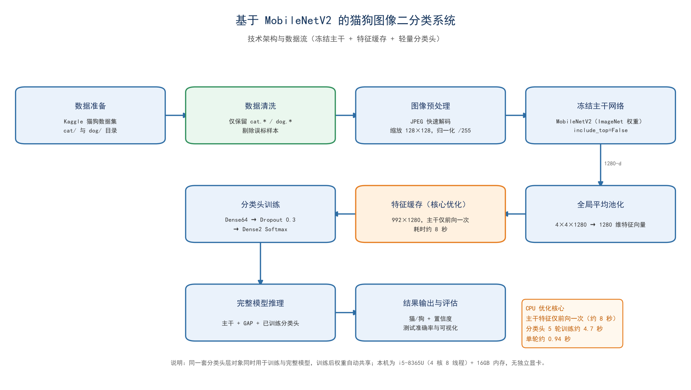
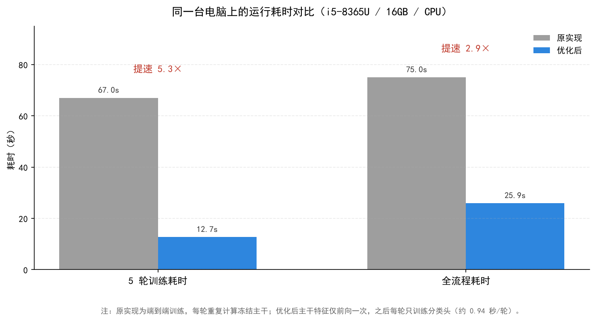

# 猫狗图像二分类项目说明文档


| 文档属性 | 内容                                                                 |
| -------- | -------------------------------------------------------------------- |
| 文档名称 | 基于 MobileNetV2 迁移学习的猫狗图像二分类项目说明文档                |
| 文档版本 | v1.1                                                                 |
| 更新日期 | 2026-10-24                                                           |
| 适用代码 | `dogs-vs-cats.py`（CPU 优化版）                                      |
| 运行环境 | Windows 10/11 + Python 3.11 + TensorFlow 2.20                        |
| 文档范围 | 项目介绍、功能演示、技术架构、使用指南、性能优化、实验分析、常见问题 |

## 目录

- [1. 项目概述](#1-项目概述)
  - [1.1 项目背景](#11-项目背景)
  - [1.2 项目目标](#12-项目目标)
  - [1.3 数据集说明](#13-数据集说明)
  - [1.4 技术路线](#14-技术路线)
  - [1.5 术语表](#15-术语表)
- [2. 功能演示](#2-功能演示)
  - [2.1 训练样本可视化](#21-训练样本可视化)
  - [2.2 训练过程与指标](#22-训练过程与指标)
  - [2.3 测试集预测](#23-测试集预测)
  - [2.4 功能清单](#24-功能清单)
- [3. 技术架构](#3-技术架构)
  - [3.1 总体架构](#31-总体架构)
  - [3.2 模块职责](#32-模块职责)
  - [3.3 模型结构](#33-模型结构)
  - [3.4 数据流与张量形状](#34-数据流与张量形状)
  - [3.5 关键设计说明](#35-关键设计说明)
- [4. 使用指南](#4-使用指南)
  - [4.1 环境要求](#41-环境要求)
  - [4.2 项目结构](#42-项目结构)
  - [4.3 数据准备](#43-数据准备)
  - [4.4 安装依赖](#44-安装依赖)
  - [4.5 运行程序](#45-运行程序)
  - [4.6 参数配置](#46-参数配置)
  - [4.7 输出说明](#47-输出说明)
  - [4.8 在 Spyder 中运行](#48-在-spyder-中运行)
- [5. 性能优化](#5-性能优化)
  - [5.1 硬件画像](#51-硬件画像)
  - [5.2 瓶颈分析](#52-瓶颈分析)
  - [5.3 优化措施](#53-优化措施)
  - [5.4 实测结果](#54-实测结果)
  - [5.5 优化边界与取舍](#55-优化边界与取舍)
- [6. 实验结果与分析](#6-实验结果与分析)
- [7. 常见问题](#7-常见问题)
- [8. 后续改进](#8-后续改进)
- [9. 附录](#9-附录)

---

## 1. 项目概述

### 1.1 项目背景

猫狗图像二分类是计算机视觉领域的经典入门任务，目标是判断一张输入图像属于“猫”还是“狗”。该任务具有以下特点：

- 图像存在姿态、光照、背景、品种等较大差异；
- 类内差异大、类间相似度高（部分小型犬与猫的轮廓接近）；
- 适合作为卷积神经网络与迁移学习算法的验证任务。

从零训练一个卷积神经网络通常需要大量标注数据和较长训练时间。迁移学习通过复用在大规模数据集（ImageNet）上预训练的模型权重，可以在小样本、低算力条件下取得较好的分类效果，因此本项目采用迁移学习方案。

### 1.2 项目目标


| 目标         | 说明                                   |
| ------------ | -------------------------------------- |
| 分类准确率   | 在测试集上正确区分猫与狗               |
| 低算力可运行 | 在没有独立显卡的普通笔记本上完成训练   |
| 训练效率     | 缩短训练时间，降低 CPU 占用与发热      |
| 可复现性     | 固定随机种子，重复运行结果稳定         |
| 工程完整性   | 覆盖数据加载、训练、评估、可视化全流程 |

### 1.3 数据集说明

项目使用 Kaggle Dogs vs. Cats 风格的猫狗数据集，原始目录结构如下：

```text
train/
├── cat/
│   ├── cat.0.jpg
│   ├── cat.1.jpg
│   └── ...
└── dog/
    ├── dog.0.jpg
    ├── dog.1.jpg
    └── ...
```

本地数据目录的实际统计与使用情况：


| 目录   | 原始文件数 | 有效样本（`cat.*` / `dog.*`） | 实际使用                |
| ------ | ---------- | ----------------------------- | ----------------------- |
| `cat/` | 12,548     | 12,500                        | 训练 496 张 + 测试 4 张 |
| `dog/` | 24,952     | 12,452                        | 训练 496 张 + 测试 4 张 |

需要特别说明的是：本地 `dog/` 目录中额外存在约 12,500 张数字命名的图片（如 `1.jpg`、`1013.jpg`）。抽样 400 张使用 ImageNet 预训练模型进行统计，其中约 **43% 为猫**，属于错误标注。若直接参与训练，模型会把大量猫的特征学习为“狗”，导致测试时猫被误判为狗。

因此，代码仅保留原始 Kaggle 命名的 `cat.*` 与 `dog.*` 样本，并在每类中取前 500 张作为候选集，其中前 496 张用于训练、最后 4 张用于测试。

### 1.4 技术路线

项目采用“预训练主干 + 轻量分类头”的迁移学习方案，整体流程如下：

1. **数据准备**：扫描数据集目录，过滤非图片文件与错误命名样本；
2. **数据预处理**：JPEG 解码、缩放至 128×128、像素归一化；
3. **特征提取**：使用冻结的 MobileNetV2 主干提取 1280 维特征；
4. **分类头训练**：训练 `Dense(64) → Dropout(0.3) → Dense(2, Softmax)`；
5. **评估与可视化**：计算测试准确率，输出训练样本、训练曲线和预测结果图。

### 1.5 术语表


| 术语                 | 含义                                                            |
| -------------------- | --------------------------------------------------------------- |
| 迁移学习             | 将在大规模数据集上预训练的模型迁移到新任务，复用其特征提取能力  |
| 主干网络（Backbone） | 负责提取图像特征的卷积网络主体，本项目为 MobileNetV2            |
| 分类头（Head）       | 接在主干之后、负责输出分类结果的轻量网络                        |
| 冻结（Freeze）       | 固定网络权重，使其在训练中不更新                                |
| 全局平均池化（GAP）  | 对每个特征通道求均值，将`4×4×1280` 特征图压缩为 `1280` 维向量 |
| 特征缓存             | 主干冻结时，预先计算并保存所有样本的特征，避免每轮重复前向      |
| 轮次（Epoch）        | 完整遍历一次训练集                                              |
| 批大小（Batch Size） | 一次参数更新所使用的样本数                                      |
| 置信度               | Softmax 输出的最大概率值，表示模型对预测结果的把握程度          |

---

## 2. 功能演示

### 2.1 训练样本可视化

程序启动后，会从训练集中随机抽取一个批次（4 张图片）并显示其类别标签，用于检查数据加载与标签对应关系是否正确。



_图 1 训练集猫狗样本可视化_

该功能对应代码中的“图1 训练集猫狗样本可视化”部分，图片上方标题显示真实标签（“猫”或“狗”）。

### 2.2 训练过程与指标

训练共 5 轮，每轮记录损失值与准确率。程序在训练结束后绘制损失曲线与准确率曲线：



_图 2 训练损失与准确率变化曲线_

各轮次指标如下：


| 轮次 | 损失 Loss | 准确率 Accuracy |
| ---- | --------- | --------------- |
| 1    | 0.2088    | 92.44%          |
| 2    | 0.0895    | 96.98%          |
| 3    | 0.0539    | 98.39%          |
| 4    | 0.0460    | 98.19%          |
| 5    | 0.0357    | 98.39%          |

从曲线可以看出：

- 第 1 轮准确率即达到 92.44%，说明 ImageNet 预训练特征具有很强的可迁移性；
- 损失在前 3 轮快速下降，第 4–5 轮趋于平稳；
- 准确率在第 3 轮达到 98.39%，之后基本稳定。

### 2.3 测试集预测

程序从每类中各取 4 张未参与训练的图片组成测试集，输出预测类别、置信度，并计算整体准确率：



_图 3 测试集 8 张图片的预测结果与置信度_

本次运行的测试结果为 **8/8，准确率 100%**，且各样本置信度均较高。

> 说明：测试集仅 8 张图片，100% 准确率不具备统计显著性，仅用于验证流程正确性。若需要更可靠的评估，请将 `TEST_EACH_NUM` 调整为 50–100。

### 2.4 功能清单


| 功能       | 说明                   | 输出                 |
| ---------- | ---------------------- | -------------------- |
| 数据扫描   | 按前缀与扩展名过滤图片 | 图片路径列表         |
| 数据划分   | 每类抽取训练集与测试集 | 992 张训练、8 张测试 |
| 图像预处理 | 解码、缩放、归一化     | `128×128×3` 张量   |
| 特征提取   | 冻结 MobileNetV2 + GAP | `992×1280` 特征矩阵 |
| 分类头训练 | Adam + 稀疏交叉熵      | 训练日志与历史指标   |
| 测试评估   | 批量推理               | 准确率与预测结果     |
| 可视化     | Matplotlib             | 4 张图表             |

---

## 3. 技术架构

### 3.1 总体架构



_图 4 系统技术架构与数据流_

系统由数据层、特征层、任务层和评估层组成。训练阶段的数据流为：

```text
数据准备 → 数据清洗 → 图像预处理 → 冻结 MobileNetV2
        → 全局平均池化 → 特征缓存 → 分类头训练
        → 完整模型推理 → 结果输出与评估
```

其中“特征缓存”是本项目针对 CPU 环境的核心优化：主干网络冻结后权重不变，同一张图片的特征在每轮训练中完全相同，因此只需计算一次并缓存，后续每轮仅训练分类头。

### 3.2 模块职责


| 模块       | 主要函数 / 变量          | 职责                                         |
| ---------- | ------------------------ | -------------------------------------------- |
| 数据扫描   | `list_images()`          | 按文件名前缀与扩展名过滤图片，排序保证可复现 |
| 数据划分   | `get_img_paths()`        | 读取`cat/`、`dog/` 路径并划分训练/测试集     |
| 图像解码   | `decode_img()`           | JPEG 解码、缩放、归一化                      |
| 数据集构建 | `make_image_ds()` 等     | 构建`tf.data.Dataset` 管道                   |
| 模型构建   | `build_models()`         | 构建完整模型、特征模型、分类头模型           |
| 运行时配置 | `configure_tf_runtime()` | 设置 CPU 线程数并处理重复初始化异常          |
| 训练控制   | `USE_FEATURE_CACHE` 分支 | 特征缓存训练或端到端训练                     |
| 评估可视化 | Matplotlib 代码段        | 生成训练样本、曲线、预测与性能图             |

各模型共享同一套层对象：

- **完整模型**：主干 + GAP + 分类头，用于推理与结构展示；
- **特征模型**：主干 + GAP，用于一次性提取特征；
- **分类头模型**：输入 1280 维特征，输出 2 类概率，用于快速训练。

由于分类头层对象被完整模型和分类头模型共同引用，训练分类头后完整模型的权重会自动同步，无需手动复制参数。

### 3.3 模型结构


| 层 / 模块                          | 输出尺寸     | 参数量        | 是否训练      |
| ---------------------------------- | ------------ | ------------- | ------------- |
| MobileNetV2（`include_top=False`） | `4×4×1280` | 2,257,984     | 否（冻结）    |
| GlobalAveragePooling2D             | `1280`       | 0             | —            |
| Dense（ReLU）                      | `64`         | 81,984        | 是            |
| Dropout（0.3）                     | `64`         | 0             | —            |
| Dense（Softmax）                   | `2`          | 130           | 是            |
| **合计**                           | —           | **2,340,098** | 可训练 82,114 |

关键配置：


| 配置项         | 取值                              |
| -------------- | --------------------------------- |
| 输入尺寸       | `128×128×3`                     |
| 预训练权重     | ImageNet                          |
| 主干是否冻结   | 是                                |
| 分类头激活函数 | ReLU（隐藏层）、Softmax（输出层） |
| Dropout 比例   | 0.3                               |
| 损失函数       | `sparse_categorical_crossentropy` |
| 优化器         | Adam（默认学习率 0.001）          |
| 批大小         | 4                                 |
| 训练轮数       | 5                                 |

### 3.4 数据流与张量形状


| 阶段         | 张量形状               | 数据类型 | 说明             |
| ------------ | ---------------------- | -------- | ---------------- |
| 原始图像     | 不定长                 | uint8    | JPEG 解码后      |
| 预处理输入   | `(batch, 128, 128, 3)` | float32  | 归一化到 [0, 1]  |
| 主干特征图   | `(batch, 4, 4, 1280)`  | float32  | MobileNetV2 输出 |
| 池化特征     | `(batch, 1280)`        | float32  | 全局平均池化     |
| 缓存特征矩阵 | `(992, 1280)`          | float32  | 约 5 MB          |
| 分类头隐藏层 | `(batch, 64)`          | float32  | Dense + ReLU     |
| 模型输出     | `(batch, 2)`           | float32  | 猫、狗概率       |

### 3.5 关键设计说明

#### 3.5.1 冻结主干与特征缓存

MobileNetV2 主干加载 ImageNet 权重后设置 `base.trainable = False`，训练过程中其参数不会更新。因此对固定输入而言，主干输出是确定的。

传统端到端训练会在每个 epoch 重新计算全部图片的主干前向，5 轮相当于重复计算 5 次。本项目的做法是：

1. 先对所有训练图片执行一次主干前向，得到 `992×1280` 特征矩阵；
2. 将特征矩阵作为分类头的输入，训练 5 轮；
3. 训练完成后，分类头与主干组合成完整模型用于推理。

由于主干不参与梯度更新，这一做法与端到端训练在数学上等价（Dropout 的随机性除外），但主干计算量从 5 次降为 1 次。

#### 3.5.2 数据清洗

如 [1.3 节](#13-数据集说明) 所述，`dog/` 目录混入了大量被错误标注的猫图。代码通过文件名前缀过滤：

```python
cat_all = list_images(cat_dir, 'cat.')
dog_all = list_images(dog_dir, 'dog.')
```

该处理避免了标签噪声对分类边界的破坏，是训练准确率从约 84% 提升到 98.39% 的主要原因。

#### 3.5.3 数据管道与打乱

数据管道使用 `tf.data` 构建：

- `tf.io.read_file` 读取文件；
- `tf.io.decode_jpeg(..., dct_method='INTEGER_FAST')` 快速解码；
- `tf.image.resize` 缩放至 128×128；
- 除以 255 归一化；
- `num_parallel_calls=2` 并行解码，匹配 4 核 CPU。

分类头训练使用 Keras `fit(..., shuffle=True)` 对全部 992 个样本做全局打乱。相比原来固定 200 容量的 shuffle 缓冲区（小于单类样本数 496），全局打乱能保证每个批次中猫狗样本充分混合，训练更稳定。

#### 3.5.4 CPU 线程控制

TensorFlow 默认按逻辑核心数（8）创建线程池。对于 4 核 8 线程的 15 W 处理器，8 线程会带来两个问题：

- 线程竞争导致上下文切换开销增加；
- 长时间满载导致温度升高、触发降频。

因此代码固定使用 4 个算子内线程和 2 个算子间线程：

```python
os.environ.setdefault("TF_NUM_INTRAOP_THREADS", "4")
os.environ.setdefault("TF_NUM_INTEROP_THREADS", "2")
```

同时在 `configure_tf_runtime()` 中捕获“运行时已初始化”异常，保证在 Spyder 等交互式环境中重复运行不会中断。

#### 3.5.5 训练与评估

- 优化器：Adam，默认学习率 0.001；
- 损失函数：稀疏类别交叉熵，标签为 0（猫）/ 1（狗）；
- 批大小：4；
- 训练轮数：5；
- 测试推理：`INFER_BATCH_SIZE=32` 批量预测，输出准确率与每张图片的置信度。

#### 3.5.6 可视化

程序生成四类图表：

1. 训练样本及标签；
2. 训练损失曲线；
3. 训练准确率曲线；
4. 测试集预测结果与置信度。

所有图表在程序末尾统一调用一次 `plt.show()`，避免逐个弹窗阻塞流程。

---

## 4. 使用指南

### 4.1 环境要求


| 项目       | 要求                                                                    |
| ---------- | ----------------------------------------------------------------------- |
| 操作系统   | Windows 10/11（已验证）；Linux/macOS 需自行验证                         |
| Python     | 3.11（已在 3.11.9 验证）；其他版本请以 TensorFlow 2.20 官方支持列表为准 |
| TensorFlow | 2.20.0                                                                  |
| NumPy      | 随 TensorFlow 自动安装                                                  |
| Matplotlib | 3.8 及以上                                                              |
| Pillow     | 用于读取图片                                                            |
| 内存       | 建议 8 GB 及以上                                                        |
| 显卡       | 无要求，CPU 即可运行                                                    |

本项目已在以下环境验证：

- CPU：Intel Core i5-8365U（4 核 8 线程，1.6 GHz）
- 内存：16 GB
- 显卡：Intel UHD 620（无 CUDA）
- 系统：Windows 11
- Python：3.11.9
- TensorFlow：2.20.0

### 4.2 项目结构

主程序文件：[dogs-vs-cats.py](../dogs-vs-cats.py)。

```text
猫狗大战/
├── dogs-vs-cats.py                          # 主程序
├── README.md                                # 仓库首页说明
├── docs/
│   ├── 项目说明文档.md                       # 本文档
│   ├── PUBLISH.md                           # 多平台发布说明
│   └── images/                              # 文档配图
│       ├── 01-training-samples.png
│       ├── 02-training-curves.png
│       ├── 03-test-predictions.png
│       ├── 04-architecture.png
│       └── 05-performance.png
├── Figure 2026-06-19 041626.png             # 优化前训练曲线（存档）
├── Figure 2026-06-19 041648.png             # 优化前预测结果（存档）
```

> `.venv/` 为本地虚拟环境，请勿提交到代码仓库。`.vscode/`、`__pycache__/` 等辅助目录同样建议排除。

### 4.3 数据准备

1. 下载 Kaggle 猫狗数据集；
2. 按 `train/cat/`、`train/dog/` 的结构整理；
3. 确保图片命名为 `cat.*` 或 `dog.*`；
4. 修改脚本顶部的 `DATA_ROOT` 为实际数据集路径：

```python
DATA_ROOT = r"G:\深度学习与开发\Jupyter Notebook\train"
```

如果使用其他数据集或命名规则，请同步修改 `list_images()` 中的前缀参数。

### 4.4 安装依赖

Windows PowerShell：

```powershell
python -m venv .venv
.\.venv\Scripts\activate
pip install tensorflow==2.20.0 matplotlib pillow
```

Linux / macOS：

```bash
python3 -m venv .venv
source .venv/bin/activate
pip install tensorflow==2.20.0 matplotlib pillow
```

如需使用国内镜像加速：

```bash
pip install tensorflow==2.20.0 matplotlib pillow -i https://pypi.tuna.tsinghua.edu.cn/simple
```

### 4.5 运行程序

```bash
python dogs-vs-cats.py
```

首次运行会自动下载 MobileNetV2 的 ImageNet 权重（约 14 MB）。运行结束后会输出：

- 模型结构摘要（总参数 2,340,098）；
- 特征提取信息（`(992, 1280)`）；
- 每轮训练日志；
- 测试集准确率；
- 4 张可视化图表。

### 4.6 参数配置

所有参数位于脚本顶部：


| 参数                | 默认值         | 说明                  | 调整建议                             |
| ------------------- | -------------- | --------------------- | ------------------------------------ |
| `DATA_ROOT`         | `G:\...\train` | 数据集根目录          | 必改为本机路径                       |
| `IMG_SIZE`          | 128            | 输入图像边长          | 96 可提速，160 可能提升精度          |
| `BATCH_SIZE`        | 4              | 分类头训练批大小      | 增大可提速，但需适当调整学习率       |
| `INFER_BATCH_SIZE`  | 32             | 特征提取 / 推理批大小 | 内存充足可增至 64                    |
| `TRAIN_EACH_MAX`    | 500            | 每类训练候选样本数    | 增大可提升精度，特征提取时间线性增加 |
| `TEST_EACH_NUM`     | 4              | 每类测试样本数        | 建议 50–100 以获得可靠指标          |
| `EPOCHS`            | 5              | 训练轮数              | 特征缓存模式下增加轮次成本很低       |
| `USE_FEATURE_CACHE` | True           | 是否启用特征缓存      | 需要微调主干时设为 False             |
| `RANDOM_SEED`       | 42             | 随机种子              | 固定值保证可复现                     |

### 4.7 输出说明


| 输出        | 说明                                 |
| ----------- | ------------------------------------ |
| 控制台日志  | 模型结构、特征形状、每轮损失与准确率 |
| 测试准确率  | 形如`测试集准确率：1.000（8/8）`     |
| 图 1        | 训练样本与标签                       |
| 图 2 / 图 3 | 训练损失、训练准确率曲线             |
| 图 4        | 测试集预测结果与置信度               |

### 4.8 在 Spyder 中运行

在 Spyder 中运行时需要注意：

1. **解释器设置**：将 Python 解释器指向项目的 `.venv\Scripts\python.exe`；
2. **重复运行报错**：TensorFlow 线程池只能初始化一次，脚本已捕获该异常；如需应用 4 线程配置，请重启内核（`Ctrl+.`）后再运行；
3. **图形显示**：Spyder 默认使用内联绘图，4 张图会依次显示在 Plots 面板；
4. **内存累积**：同一内核多次运行会累积模型与图对象，建议定期重启内核。

---

## 5. 性能优化

### 5.1 硬件画像


| 项目 | 配置                                      | 对训练的影响                       |
| ---- | ----------------------------------------- | ---------------------------------- |
| CPU  | Intel Core i5-8365U，4 核 8 线程，1.6 GHz | 无独显时承担全部计算；低功耗易降频 |
| 内存 | 16 GB                                     | 足够缓存特征与图像                 |
| 显卡 | Intel UHD 620                             | 无 CUDA，TensorFlow 只能使用 CPU   |
| 硬盘 | 256 GB SSD                                | 数据读取不是主要瓶颈               |
| 散热 | 实测温度约 81°C                          | 长时间训练可能触发温度墙           |

### 5.2 瓶颈分析

原实现采用端到端训练，每轮都要对全部训练图片执行一次 MobileNetV2 前向。在 CPU 上：

- 单轮训练约 12 秒，5 轮约 60 秒以上；
- 主干计算占单轮时间的绝大部分；
- 主干被冻结，重复计算的特征完全相同，属于无效计算。

因此，**减少主干重复前向**是最大的优化空间。

### 5.3 优化措施


| 序号 | 优化项   | 具体做法                                 | 效果                           |
| ---- | -------- | ---------------------------------------- | ------------------------------ |
| 1    | 特征缓存 | 冻结主干只前向一次，缓存`992×1280` 特征 | 5 轮训练从约 67 秒降至 12.7 秒 |
| 2    | 线程控制 | 固定 4 个算子内线程、2 个算子间线程      | 降低竞争与发热，运行更稳定     |
| 3    | 快速解码 | `INTEGER_FAST` 解码 + 2 路并行           | 首次特征提取约 8 秒（含解码）  |
| 4    | 全局打乱 | 分类头训练使用 Keras 全局 shuffle        | 修复同类样本扎堆，收敛更稳     |
| 5    | 数据清洗 | 仅保留`cat.*` / `dog.*`                  | 训练准确率提升至 98.39%        |
| 6    | 批量推理 | `INFER_BATCH_SIZE=32`                    | 测试推理更快                   |
| 7    | 单次绘图 | 所有图最后统一`plt.show()`               | 避免多次阻塞                   |
| 8    | 异常容错 | 捕获线程配置的`RuntimeError`             | Spyder 重复运行不中断          |

### 5.4 实测结果



_图 5 同一台电脑上的运行耗时对比_


| 指标         | 优化前   | 优化后  | 提升               |
| ------------ | -------- | ------- | ------------------ |
| 5 轮训练耗时 | 约 67 秒 | 12.7 秒 | 约 5.3 倍          |
| 全流程耗时   | 约 75 秒 | 25.9 秒 | 约 2.9 倍          |
| 训练准确率   | 约 84%   | 98.39%  | 提升约 14 个百分点 |
| 测试集       | 5/8      | 8/8     | —                 |

优化后各阶段耗时（单次实测）：


| 阶段                         | 耗时                    |
| ---------------------------- | ----------------------- |
| 主干特征提取（992 张）       | 8.0 秒                  |
| 分类头 5 轮训练              | 4.7 秒（约 0.94 秒/轮） |
| 测试推理（首次含计算图构建） | 2.2 秒                  |
| TensorFlow 导入、绘图及其他  | 约 11 秒                |
| **全流程合计**               | **25.9 秒**             |

> 由于本机为 15 W 低功耗处理器，长时间满载会触发降频，实测总耗时有约 25–40 秒的波动，属于正常现象。表中的“全流程耗时”为程序自动执行时间，不包含用户查看图表的时间。

### 5.5 优化边界与取舍

1. **特征缓存的适用前提**：主干保持冻结。若后续需要解冻部分层进行微调，特征会随权重变化，必须关闭 `USE_FEATURE_CACHE`，回到端到端训练。
2. **不支持像素级数据增强**：特征缓存后无法对原图做随机裁剪、翻转等增强；如需增强，应关闭缓存或改用特征空间增强。
3. **精度与速度的取舍**：缩小输入尺寸（如 96×96）或使用更窄的 MobileNetV2（`alpha=0.75`）可以进一步提速，但会改变实验设定与报告数据。
4. **测试集规模**：8 张测试图只能验证流程，不能代表真实泛化能力。

---

## 6. 实验结果与分析

### 6.1 训练结果


| 轮次 | 损失   | 准确率 |
| ---- | ------ | ------ |
| 1    | 0.2088 | 92.44% |
| 2    | 0.0895 | 96.98% |
| 3    | 0.0539 | 98.39% |
| 4    | 0.0460 | 98.19% |
| 5    | 0.0357 | 98.39% |

### 6.2 测试结果

- 测试样本：猫 4 张、狗 4 张，共 8 张；
- 预测正确：8 张；
- 准确率：100%；
- 各样本置信度均较高，预测结果见[图 3](#23-测试集预测)。

### 6.3 结果分析

1. **预训练特征有效**：仅训练 5 轮、每轮 992 个样本，准确率即达到 98% 以上，说明 ImageNet 特征对猫狗分类具有很好的迁移性。
2. **数据清洗影响显著**：剔除 `dog/` 中约 43% 的误标猫图后，分类边界不再被污染，训练准确率由约 84% 提升至 98.39%。
3. **训练稳定**：损失单调下降，准确率在第 3 轮后趋于稳定，未出现明显震荡。
4. **特征缓存等价有效**：由于主干冻结，缓存特征训练与端到端训练在数学上等价，精度未因加速而下降。

### 6.4 局限性


| 局限性       | 说明                         | 改进方向                      |
| ------------ | ---------------------------- | ----------------------------- |
| 测试集过小   | 仅 8 张，100% 不具有统计意义 | 每类取 50–100 张             |
| 无验证集     | 无法监控过拟合与调参         | 从训练集划分 10%–20% 验证集  |
| 仅训练分类头 | 主干未针对猫狗任务微调       | 解冻后部卷积层做小学习率微调  |
| 无数据增强   | 泛化能力有限                 | 随机翻转、裁剪、颜色扰动      |
| 单机 CPU     | 训练规模受限                 | 使用 GPU 或云端环境扩大数据量 |

---

## 7. 常见问题

### Q1：在 Spyder 中第二次运行报错 `Intra op parallelism cannot be modified after initialization`

**原因**：TensorFlow 线程池在首次运行时已初始化，之后不能再修改。

**处理**：脚本已通过 `try/except` 捕获该异常并继续运行。如需应用 4 线程配置，请重启 Spyder 内核（`Ctrl+.`）后运行。正式实验前建议先重启一次内核。

### Q2：报错 `FileNotFoundError: 训练目录缺少 cat 或 dog 子目录`

**原因**：`DATA_ROOT` 路径错误，或目录结构不符合要求。

**处理**：确认路径下存在 `cat/` 与 `dog/` 两个子目录，并修改脚本顶部的 `DATA_ROOT`。

### Q3：图表中的中文显示为方块

**原因**：Matplotlib 找不到中文字体。

**处理**：确认系统安装 SimHei（黑体）；或在脚本中替换为其他已安装的中文字体，例如：

```python
plt.rcParams['font.sans-serif'] = ['Microsoft YaHei']
```

### Q4：没有独立显卡，能否运行

可以。项目本身就是为 CPU 环境优化设计的，代码会主动屏蔽 GPU 探测。CPU 模式下 5 轮训练约 13 秒。

### Q5：训练准确率很高，但测试准确率不稳定

**原因**：测试集只有 8 张，随机性很大；也可能与数据分布、标签质量有关。

**处理**：增大 `TEST_EACH_NUM`（建议 50–100），并检查数据集命名与标签是否正确。

### Q6：可以增加训练数据量吗

可以。修改 `TRAIN_EACH_MAX` 即可。特征缓存模式下，特征矩阵大小约为 `样本数 × 1280 × 4` 字节，内存占用很小；主要增加的是首次特征提取时间（近似线性增长）。

### Q7：如何保存训练好的模型

当前脚本未包含保存逻辑，可在训练结束后添加：

```python
full_model.save("dogs_vs_cats_mobilenetv2.keras")
```

加载时使用：

```python
model = tf.keras.models.load_model("dogs_vs_cats_mobilenetv2.keras")
```

---

## 8. 后续改进

1. **扩大测试集**：将 `TEST_EACH_NUM` 设置为 50–100，得到更可靠的准确率、精确率、召回率与混淆矩阵。
2. **增加验证集**：从训练集中划分验证集，结合 EarlyStopping 与学习率衰减。
3. **数据增强**：随机水平翻转、随机裁剪、亮度与对比度扰动，提升泛化能力。
4. **主干微调**：解冻 MobileNetV2 的最后若干层，使用较小学习率微调，进一步降低错误率。
5. **模型导出与部署**：保存为 `.keras` 或 SavedModel，封装为命令行或 Web 推理服务。
6. **模型对比**：在同一数据集上比较 MobileNetV2、ResNet50、EfficientNetB0 等模型的精度与速度。
7. **可视化增强**：增加混淆矩阵、Grad-CAM 热力图，提升结果解释性。

---

## 9. 附录

### 9.1 参考资料

1. Sandler M., Howard A., Zhu M., et al. MobileNetV2: Inverted Residuals and Linear Bottlenecks. CVPR, 2018.
2. TensorFlow 官方文档：https://www.tensorflow.org/
3. Keras Applications：https://keras.io/api/applications/
4. Kaggle Dogs vs. Cats：https://www.kaggle.com/c/dogs-vs-cats

### 9.2 版本记录


| 版本 | 日期       | 说明                                       |
| ---- | ---------- | ------------------------------------------ |
| v1.0 | 2026-06-19 | 初始实验版本：端到端训练、基础可视化       |
| v1.1 | 2026-10-24 | CPU 优化、数据清洗、线程容错、补充项目文档 |

### 9.3 数据与版权说明

- 数据集版权归 Kaggle 及原始作者所有，本项目仅用于课程学习与研究；
- MobileNetV2 预训练权重由 Keras Applications 提供，遵循其开源许可；
- 本项目代码仅用于学习与交流，请勿用于商业用途。
